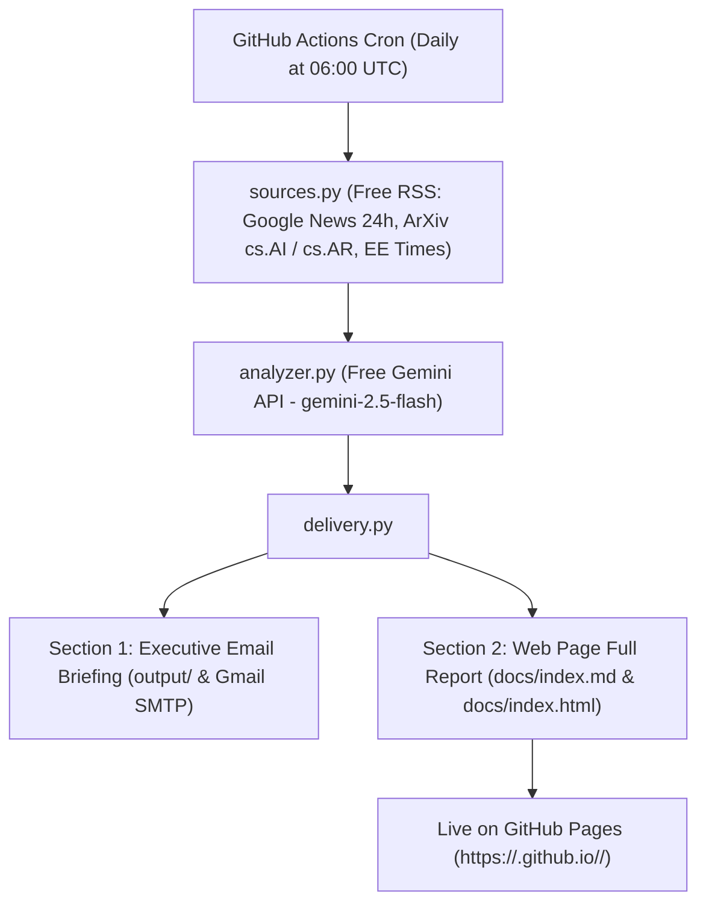

# ⚡ Autonomous Daily AI & Semiconductor Analyst ($0 Budget)

An enterprise-grade, completely autonomous intelligence system that monitors, synthesizes, and evaluates the last 24 hours of breakthroughs in **General AI** and **Deep-Tech Hardware (Semiconductors, VLSI, EDA, ASICs, Chiplets, and Foundries)**.

Designed to operate with **$0 monthly infrastructure costs** using free curated RSS feeds, the free tier of Google Gemini API (AI Studio), GitHub Actions, and GitHub Pages.

---

## 🏗️ Architecture & $0 Stack



| Component | Free Tool | Cost |
| :--- | :--- | :--- |
| **Data Sourcing** | Curated RSS Feeds (Google News 24h filter, ArXiv, Tech Feeds) | **$0.00** |
| **Intelligence Engine** | Google Gemini API (`gemini-2.5-flash`) via Google AI Studio | **$0.00** (Free tier: up to 1,500 requests/day) |
| **Cloud Scheduler** | GitHub Actions (`ubuntu-latest` cron job) | **$0.00** (2,000 free runner mins/mo) |
| **Live Web Hosting** | GitHub Pages (`/docs` directory) | **$0.00** (Free hosting + custom domain) |
| **Email Dispatch** | Standard Python `smtplib` via Gmail App Password | **$0.00** |

---

## 📁 Project Structure

```
AI_Updates_Proj/
├── .github/
│   └── workflows/
│       └── daily_briefing.yml   # Daily scheduled cloud execution
├── docs/
│   ├── index.html              # Sleek dark-themed responsive web dashboard
│   ├── index.md                # Latest live Markdown web report
│   └── archive/                # Historical daily briefings
├── output/
│   └── latest_email_briefing.txt # Latest Section 1 executive summary
├── config.py                   # Environment config and feed endpoints
├── sources.py                  # Ingestion engine with 24-hour freshness filter
├── analyzer.py                 # Gemini synthesis engine (strictly adheres to prompt)
├── delivery.py                 # Markdown & HTML publisher + Email/Telegram dispatch
├── main.py                     # Main execution orchestrator
├── requirements.txt            # Python dependencies
├── .env.example                # Template for environment variables
└── README.md                   # Documentation
```

---

## 🚀 5-Minute Quickstart (Zero Budget Setup)

### Step 1: Get Your Free Gemini API Key
1. Go to [Google AI Studio](https://aistudio.google.com/).
2. Sign in with any Google account and click **"Get API key"**.
3. Copy the key (Free tier has generous rate limits for automated daily runs).

---

### Step 2: Push This Folder to a New GitHub Repository
1. Initialize git and commit:
   ```bash
   git init
   git add .
   git commit -m "Initial commit of Autonomous Analyst"
   ```
2. Create a new repository on GitHub (Public or Private) and push:
   ```bash
   git remote add origin https://github.com/<YOUR_USERNAME>/<YOUR_REPO_NAME>.git
   git branch -M main
   git push -u origin main
   ```

---

### Step 3: Add Your Free API Key to GitHub Secrets
1. In your GitHub repository, navigate to **Settings** > **Secrets and variables** > **Actions**.
2. Click **New repository secret**.
   - **Name:** `GEMINI_API_KEY`
   - **Secret:** Paste your Gemini API key from Step 1.
3. *(Optional)* Add `WEBSITE_URL`:
   - `https://<YOUR_USERNAME>.github.io/<YOUR_REPO_NAME>/`

---

### Step 4: Turn On Free GitHub Pages
1. In your GitHub repository, go to **Settings** > **Pages**.
2. Under **Build and deployment**:
   - Source: **Deploy from a branch**
   - Branch: `main`
   - Folder: `/docs`
3. Click **Save**. Within 60 seconds, your daily web briefing is live at:
   `https://<YOUR_USERNAME>.github.io/<YOUR_REPO_NAME>/`

---

### Step 5: (Optional) Set Up Free Daily Email Delivery
If you want Section 1 delivered directly to your inbox every morning:
1. In your Google account, create an [App Password](https://myaccount.google.com/apppasswords) (Name it `GitHub Actions Analyst`).
2. Add these additional secrets in GitHub:
   - `EMAIL_ENABLED`: `true`
   - `SMTP_USER`: `your_email@gmail.com`
   - `SMTP_PASSWORD`: `your_16_character_app_password`
   - `EMAIL_RECIPIENTS`: `your_email@gmail.com`

---

## 🧪 Testing On-Demand

You can trigger the pipeline anytime without waiting for the daily cron:
- **On GitHub:** Go to the **Actions** tab > click **Daily AI & Semiconductor Briefing** > click **Run workflow**.
- **Locally:** 
  ```bash
  pip install -r requirements.txt
  # Set GEMINI_API_KEY in .env
  python main.py
  ```
